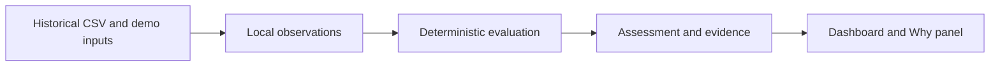

# Fadoua · Evidence, demo and acceptance

**Project:** NASA Space Apps — offline astronaut health monitoring prototype (two-day team plan)
**How to use this file:** give it to your agent session together with the repo path and branch name. Sections 4–5 are your task list; Part A is your original brief; Part C is the shared contract/rules copied verbatim from the plan.

## 0. Quick card

| Item | Value |
|---|---|
| Branch | `build/demo-qa` |
| You own | Evidence notes, manual acceptance checklist, pitch and recording |
| Write only in | `evidence/`, `acceptance/`, `demo/` |
| Read-only for you | Everything else. Any rule-configuration change goes to El Mahdi |
| Day 1 target | Prepare the walkthrough, source labels and acceptance steps |
| Day 2 target | Run the offline demo on the merged build, record it and prepare submission text |
| Checks you must pass | A01, B02, X01 must be reproducible by a teammate from your checklist; you co-own A01, B02, X01 |
| You unblock | Everyone (checklist), El Mahdi (submission draft review) |
| You depend on | El Mahdi (contract/examples), Hamza (launch command), Amine/Mohsine (UI labels), Hajar (numbers) |

## 1. Operating rules for your agent session (read first)

1. **Source-of-truth order.** (a) `contracts/v1.md` and the rule policy in the kickoff commit, (b) the task list in this file, (c) the plan text in Part C. If an example JSON differs from an approved contract, use the contract and flag the example to El Mahdi.
2. **Inspect before editing.** Read the repository's own instructions, run `git status --short`, check the current branch, and list the files that already exist. Use the paths, toolchain, test runner and dependency manifests that are already in the repo. Do not install or add dependencies; ask Hamza and El Mahdi.
3. **Stay inside your paths.** Write only inside the paths in your quick card. Everything else is read-only. Leave existing changes by other people intact. Commit only your own files. Never merge; El Mahdi merges to `main`.
4. **Never invent.** Do not make up field names, endpoints, IDs, file paths, thresholds, column names, reason codes, labels or measurements. Take them from the contract, the plan text in Part C, or the real data file. If something is not specified, **stop that item and report it** in this format: *exact file or field → what you observed → who owns it → the smallest decision needed.* Then continue with work that can be verified independently.
5. **Stubs are labeled.** Use the named stub or fixture while waiting for another owner. Keep stubs in preview or tests only and label them **Fixture preview** or similar. A stub passing is not an integrated pass.
6. **Status words.** Report every check as exactly one of **Pass**, **Fail**, **Blocked** or **Not run**. Include the exact command or click path and the observed result. A check that depends on something not yet merged stays **Blocked**.
7. **Claims discipline.** Derive times, ages and statuses from the data or the contract. Leave missing data missing. Radiation values are *detector readings* from historical ISS data, not crew exposure; the cause of the RadLab gap is *unknown*. Crew baselines and the 310 ms sample are *synthetic*. Thresholds and windows are *prototype settings*, not clinical cutoffs. Nothing in the app diagnoses anything.
8. **Scope.** Two scenarios only (`radlab_stale`, `sleep_vigilance`), one demo crew member (`crew-demo-1`), one detector pair (`DosTel1`, `DosTel2`). New scenarios, alarms, live feeds, extra sensors and local-AI paraphrase are backlog.
9. **No drive-by changes.** No broad formatting, renames or cleanup outside your task.

## 2. Facts specific to your role

- **Your job is to catch unsupported claims.** Every statement in the app text, checklist and pitch must trace to (a) the historical RadLab archive, (b) the labeled synthetic crew fixture, or (c) a cited source.
- **What is measured / simulated / reported:**
  - Radiation values come from **historical ISS detectors** (DosTel1, DosTel2 in Columbus); they are **detector readings**, not crew exposure. The **cause of the archive gap is unknown**.
  - The crew sleep baseline, recent sleep rows and the 310 ms sample are **synthetic**. A real browser reaction result belongs to that **device session** (**Recorded on this device**).
  - Thresholds and windows (300 s, 60 min, 20%, 3 slots, 5-night baselines) are **versioned prototype settings**, not clinical cutoffs. The rules report a comparison with the demo baseline; they establish neither a diagnosis nor a cause.
- **Registry entries:** `EVID_SLEEP_003` and `EVID_COG_001` (reported by "Agent 2"). Before quoting either, verify the **exact record wording and source**. If the registry or a source is unavailable, mark the claim **unverified** and use wording supported by what you actually have. Leave the existing registry intact unless you have a concrete citation correction with a source.
- **Available sources named in the plan:** NASA RadLab API (`https://visualization.osdr.nasa.gov/radlab/gui/data-api/`) and NASA "Sleep on Station" (`https://www.nasa.gov/humans-in-space/science-in-space-week-of-sept-15-2023-sleep-on-station/`). The Codex planted sleep/reaction association is a *synthetic pipeline check*, not evidence.
- **RadLab file:** `iss-radlab-dostel-2022-04-01.csv`, SHA-256 `be73563615dbbd28b0b8548a0b9ba40c2059f3dc68ef8941203eb350dcc9e9fb`; 84 DosTel1 + 96 DosTel2 records.
- **Pre-computed consistency checks you can verify by hand:** 23:20:00 − 23:12:25 = 7 min 35 s = 455 s; 23:12:25 + 301 s = 23:17:26 (incident `opened_at`); sleep baseline median of 450, 440, 450, 460, 445 = 450; reaction baseline median of 245, 250, 255, 248, 252 = 250; 310/250 = 1.24 (+24%); 450 − 380 = 70, 450 − 370 = 80, 450 − 420 = 30.
- Record each pass/fail with the **build commit** and the **scenario timestamp**. If the app is incomplete, record **Blocked** with the owning teammate.

## 3. Shared quick facts and unresolved decisions

### 3.1 Numbers you can rely on (all derived from the plan; re-check against `contracts/v1.md`)

| Topic | Fact |
|---|---|
| RadLab file | `iss-radlab-dostel-2022-04-01.csv`, SHA-256 `be73563615dbbd28b0b8548a0b9ba40c2059f3dc68ef8941203eb350dcc9e9fb` |
| RadLab counts | 84 `DosTel1` records + 96 `DosTel2` records |
| RadLab replay range | `2022-04-01T23:00:00Z` → `2022-04-02T01:04:59Z` (fixed). CSV timestamps have no offset; the adapter reads them as UTC and keeps the raw string in `source_timestamp` |
| RadLab metric / unit | `absorbed_dose_rate`, `µGy/h`; `subject_id` is `null` (no astronaut is assigned to either detector); provenance `REAL_HISTORICAL` |
| Freshness rule | `SOURCE_FRESHNESS@1`: age ≤ 300 s → `current`; age ≥ 301 s → `stale`; no eligible reading → `missing`. Incident opens at previous reading time + 301 s (if no newer reading exists at that instant) and closes on the first later reading |
| RadLab checkpoints | `23:12:25` both current · `23:17:25` DosTel1 current at exactly 300 s · `23:17:26` DosTel1 stale, incident opens · `23:20:00` ages 455 s (DosTel1) and 0 s (DosTel2) · `23:30:00` both current, one resolved DosTel1 incident. (455 s = 7 min 35 s = 23:20:00 − 23:12:25.) The plan does **not** state the exact second DosTel1 recovers; read it from the CSV, never hard-code it |
| Behavioral range | initial time and range start `2026-01-10T09:00:00Z`, range end `2026-01-10T10:00:00Z`; baseline and sleep rows before the range are visible as history |
| Sleep baseline | 5 seeded nights, Jan 1–5 2026 at 07:00Z: 450, 440, 450, 460, 445 min → median **450 min** |
| Reaction baseline | 5 seeded tests, Jan 1–5 2026 at 09:00Z: 245, 250, 255, 248, 252 ms → median **250 ms** |
| Recent sleep slots | Jan 8 = 380 min (70 below baseline), Jan 9 = 370 min (80 below), Jan 10 = 420 min (30 below), each at 07:00Z. Two slots are ≥ 60 min below → short-sleep condition **true** |
| Seeded sample reaction | **310 ms** at `2026-01-10T09:01:00Z`; 310 / 250 = +24% (≥ 20% → slower condition **true**) → `watch`, title **Sleep and vigilance change** |
| Variants | 270 ms comparable result = +8% → `observed`. One sleep night missing → `insufficient_data`. Mismatched reaction profile → `insufficient_data` |
| Reaction metadata | `task_version: "demo-rt-v1"`, `input_profile: "seeded-demo"` (seeded) or `"browser-keyboard"` (new live capture), plus `trial_count`, `false_starts`, `completed` |
| Provenance | `REAL_HISTORICAL`, `SYNTHETIC`, `LIVE_MEASURED`. Sample sleep/self-report entries → `SYNTHETIC`. Reaction test actually run on the laptop → `LIVE_MEASURED` |
| UI labels | **Historical NASA telemetry** (`REAL_HISTORICAL`), **Synthetic crew scenario** (`SYNTHETIC`), **Recorded on this device** (`LIVE_MEASURED`). Mapping inferred from section 1 and the provenance list; confirm with Fadoua if in doubt |
| IDs | `source_id`: `DosTel1`, `DosTel2`, `crew_sleep_log`, `crew_self_report`, `reaction_task`. Subject: `crew-demo-1`. Resource: `local_reaction_task`. Actions: `view_source_history`, `start_reaction_check`, `review_available_inputs`. Rules: `SOURCE_FRESHNESS@1`, `SLEEP_VIGILANCE@1`. Baseline id seen in Example B: `crew-demo-sleep-v1` |
| Assessment states | `observed`, `watch`, `insufficient_data`. Source states: `current`, `stale`, `missing`, `invalid`, `conflicting`. Incident states: `open`, `resolved` |
| HTTP | Create run `201`; unknown run `404`; invalid payload/metric/source/unit/time range `422`; first submission `201`; identical retry `200` (same IDs); same submission ID with a different payload `409` |

### 3.2 Things the plan does NOT settle (do not guess — ask the owner)

| # | Open item | Owner to decide | Who is affected |
|---|---|---|---|
| D1 | Format of **real importer** observation IDs. Example IDs like `d1-231225` are *opaque fixture IDs*; the real importer generates stable IDs from source + normalized time. Tests against the integrated app must not hard-code example IDs unless the contract defines the format | El Mahdi + Hamza | Hamza, Amine, Fadoua, tests |
| D2 | IDs for the 5 reaction-baseline rows and the 310 ms sample row in the crew fixture | Hajar + Hamza | Hajar, Hamza, El Mahdi |
| D3 | Values of `trial_count` and `false_starts` on seeded reaction rows | El Mahdi | Hajar, Hamza |
| D4 | Metadata **key name** for the browser's real capture time (plan says "record capture time separately in metadata") | El Mahdi + Hamza | Mohsine, Hamza |
| D5 | Reaction baseline id (only `crew-demo-sleep-v1` appears in the plan), exact `unavailable_reason` text, assessment title when the result is `observed`, and the full list of `reason_code` values beyond those in the two examples | El Mahdi (publish in `contracts/v1.md`) | Amine, Mohsine, Fadoua |
| D6 | Status code when `POST …/observations` is sent to a `radlab_stale` run (plan says behavioral only and "validates scope"; `422` is the natural fit) and when `as_of` is outside the run range (plan: invalid time range → `422`) | El Mahdi + Hamza | Hamza |
| D7 | How history data (for `view_source_history`) reaches the dashboard: props from the shell vs. its own request | Hamza + Amine | Amine, Hamza |
| D8 | Format of `submission_id` (any unique opaque string is assumed OK) | Hamza | Mohsine |
| D9 | Event deadline and the team's internal freeze / submission times | El Mahdi (after the team confirms the event deadline) | everyone |
| D10 | Repo layout, existing toolchain and test runner beyond the paths named in the plan | Hamza (inspect the repo) | everyone |
| D11 | Exact control names/labels in the UI (needed for click paths) | Amine / Mohsine → Fadoua | Fadoua |

## 4. Task list

| ID | Day | Task | Depends on | Deliverable |
|---|---|---|---|---|
| FD-01 | 1 | Inspect repo, branch | — | Branch `build/demo-qa`, notes |
| FD-02 | 1 | Cross-check contract examples vs demo instructions | EM-03…EM-05 | Discrepancy list to El Mahdi |
| FD-03 | 1 | Claim/source table | FD-02 | `evidence/` table |
| FD-04 | 1 | Verify registry records and source wording | registry access | `evidence/` notes (verified/unverified) |
| FD-05 | 1 | Manual acceptance checklist (A01–A04, B01–B05, X01) | FD-02 | `acceptance/` one-page checklist |
| FD-06 | 1–2 | Wording review of labels, RadLab gap text and thresholds | UI available | `evidence/` review notes |
| FD-07 | 1 | Two-minute pitch script with claim traceability | FD-03 | `demo/` script |
| FD-08 | 2 | Screenshots and submission copy | integrated build | `demo/` files |
| FD-09 | 2 | Offline acceptance run on the merged build | merged build | Result table with commit + timestamps |
| FD-10 | 2 | Record the backup demo | FD-09 | Recording + location note |
| FD-11 | 2 | Hand submission draft to El Mahdi; PR | FD-08…FD-10 | PR + draft |

## 5. Task details

### FD-01 · Inspect and set up
1. Read repo instructions; `git status --short`; make sure you are on `build/demo-qa`.
2. List what already exists in `evidence/` (the registry) so you do not overwrite it.
3. Do not edit outside `evidence/`, `acceptance/`, `demo/`.

### FD-02 · Cross-check examples against the demo instructions (kickoff)
1. Compare `contracts/examples/radlab-stale.json` and `sleep-vigilance-missing.json` with Part C §3–§4 and §7.
2. Check the arithmetic listed in section 2 (455 s; 23:17:26; 450 and 250 medians; −70/−80/−30; +24%).
3. Check that incident `opened_at` (23:17:26Z) equals last reading + 301 s and that `age_seconds` agrees with `as_of`.
4. Report any disagreement to El Mahdi using: *exact file or field → what you observed → owner → smallest decision needed.*
**Done when:** El Mahdi has your list (or "no discrepancies found" with what you checked).

### FD-03 · Claim/source table (`evidence/`)
Build a table with these columns: **Claim text · Where it appears (app/pitch/submission) · Type (measured / simulated / rule output) · Source (archive, fixture, citation) · Status (verified / unverified)**. Cover at least:
- "ISS detector readings from historical RadLab data" → measured, archive (SHA-256 above).
- "DosTel1 went quiet; cause unknown" → measured gap, archive.
- "Crew baseline and 310 ms sample" → simulated, labeled synthetic fixture.
- "Live reaction result" → measured on this device, device session.
- "Thresholds/windows" → prototype settings, versioned in `rules/`.
- "Sleep and vigilance change" → rule output; comparison with demo baseline; no diagnosis.

### FD-04 · Verify registry and source wording
1. Look up `EVID_SLEEP_003` and `EVID_COG_001` in the registry; record the **exact** record wording and the source it cites.
2. Check the NASA "Sleep on Station" page supports whatever you plan to say; quote nothing you have not read.
3. If the registry or a source is unavailable, mark each affected claim **unverified** and write wording supported by what you do have.
4. Do not edit the existing registry unless you have a concrete citation correction with a source.

### FD-05 · Manual acceptance checklist (`acceptance/`, one page)
For each of A01, A02, A03, A04, B01, B02, B03, B04, B05, X01 write: **ID · who owns it · click path · expected screen · Pass/Fail/Blocked/Not run box · build commit · scenario timestamp · notes**. Expected screens come from the contract and Part C §7:
- **A01** — `sha256sum` of the raw CSV equals the plan checksum; 84 DosTel1 + 96 DosTel2 imported; no astronaut subject on either detector.
- **A02** — `23:12:25` both current; `23:17:25` DosTel1 current at 300 s; one second later stale.
- **A03** — `23:20:00` ages 455 s / 0 s; Why? shows both observations; advancing inside the gap shows one open incident.
- **A04** — `23:30:00` both current; one resolved DosTel1 incident; seek back before recovery shows no future reading or closure.
- **B01** — `2026-01-10T09:00:00Z` insufficient data; Why? shows 380, 370, 420 min vs 450; mood/fatigue/stress blank allowed.
- **B02** — `09:01:00Z` seeded 310 ms sample is 24% above 250 ms; both conditions true; Why? shows baseline and observed values.
- **B03** — fixture variants: 270 ms → `observed`; a missing sleep night or incomparable test → `insufficient_data`.
- **B04** — task resource disabled → reason + **Review available inputs**; assessment pending.
- **B05** — same check-in twice, one submission ID → same IDs, one batch; changed payload → 409; new run only has its own seeded records.
- **X01** — Wi-Fi off before launching the prepared build; both scenarios, evidence drawers, local inputs and reset work; repeat both demos from a fresh launch.
Write exact control names once the UI is available (D11); until then mark steps as *to be confirmed with Amine/Mohsine*.
**Done when:** a teammate can reproduce A01, B02 and X01 from the checklist alone.

### FD-06 · Wording review
1. In the running UI check labels: **Historical NASA telemetry**, **Synthetic crew scenario**, **Recorded on this device**.
2. RadLab gap wording must say what is known (the readings stopped for N seconds) and that the cause is **unknown**.
3. Thresholds appear as prototype choices; no diagnostic or clinical language; "detector readings", never "crew exposure".
4. Report wording problems to the owner (Amine for dashboard, Mohsine for check-in, El Mahdi for engine strings).

### FD-07 · Two-minute pitch (`demo/`)
Start from the plan's run of show (Part C §8, "Two-minute run"):
- 0:00–0:20 intro line.
- 0:20–0:55 RadLab: seek to `23:20:00`, open **Why?** on the stale detector, point to both source timestamps, advance to `23:30:00`, show the resolved incident.
- 0:55–1:35 crew scenario: show the missing reaction result, load the labeled sample result, open **Why?** to show the sleep baseline, vigilance baseline, timestamps and rule.
- 1:35–2:00 offline local build and rule reference; first scenario = archived NASA telemetry, second = synthetic crew data informed by published research.
Annotate every sentence with its claim ID from the FD-03 table.

### FD-08 · Screenshots and submission copy
1. Capture screenshots of both scenarios from the integrated build; label each **Integrated run**.
2. Write the submission text using only claims that are **verified** or clearly marked as prototype/synthetic.
3. Keep the claim/source table next to the copy.

### FD-09 · Offline acceptance run (Day 2)
1. Confirm Wi-Fi is **off before launch** and record how you confirmed it.
2. Launch the merged build with Hamza's documented command; run A01–A04, B01–B05 and X01 from the checklist.
3. Record for each: Pass/Fail/Blocked/Not run, build commit SHA, scenario timestamp, notes. If anything is incomplete mark **Blocked** with the owning teammate.

### FD-10 · Record the backup demo
Record the full two-minute walkthrough offline from a fresh launch on the merged build; store it and write down the recording location.

### FD-11 · Handoff
1. PR includes the checklist, pitch, offline-run result and the recording location.
2. Give El Mahdi the recording location and submission draft for review (he approves the submission build).

## 5.1 Dependencies and handoffs

| With | You give | You get |
|---|---|---|
| El Mahdi | Discrepancy list, claim table, submission draft | Contract/examples, rule IDs |
| Hamza | A01/X01 results, launch feedback | Launch command and expected screen |
| Amine / Mohsine | Wording feedback | Control names (D11) |
| Hajar | — | Numbers for B02 |

## 6. Handoff checklist and PR template

Before you hand off:

1. `git status --short` and `git diff --check` — both clean (no stray files, no whitespace errors).
2. Review the **whole branch diff from the kickoff commit**, plus untracked files.
3. Check every changed path against the "Write only in" list on your quick card.
4. Run the acceptance checks you own and record each as Pass / Fail / Blocked / Not run.

Paste this into the PR description:

```
Branch:
Base (kickoff commit SHA):
Changed files:
How to verify (exact command or click path):
Checks (ID — status — exact command — observed result):
  e.g. A03 — Blocked — waiting on engine PR from El Mahdi
Preview vs integrated: (label every screenshot/recording "Fixture preview" or "Integrated run")
Open questions / blockers (owner + smallest decision needed):
Shared-file changes requested (path, intended diff, owner):
```

## Part A · Your original brief from the plan (verbatim)

> **Goal:** Make the integrated app easy to demonstrate and catch wording or behavior that the evidence cannot support.
>
> **Write in:** `evidence/`, `acceptance/`, `demo/`. Use the rule IDs, source links and acceptance table in this plan. Ask El Mahdi to make any rule configuration change.
>
> **Build in order:** (1) Write a one-page manual checklist with the click path, expected screen and pass/fail box for each demo checkpoint. (2) Cross-check source labels, the RadLab gap wording and the two behavioral evidence IDs. Identify the demo thresholds as prototype choices. (3) Prepare the two-minute pitch, screenshots and submission copy. Once the integrated build is ready, run the walkthrough with Wi-Fi off and record the backup demo.
>
> **Done when:** A teammate can reproduce A01, B02 and X01 from your checklist. Every claim in the pitch can be traced to the archive, the labeled synthetic fixture or a cited source. Your PR includes the checklist, pitch, result of the offline run and the location of any recording.

> **Inputs and artifacts.** Use sections 7 and 8 and the two available fixtures. Write a checklist in `acceptance/`, a script and submission copy in `demo/`, and source notes in `evidence/`. Keep a claim/source table covering what is measured, what is simulated and what each rule reports. Leave the existing registry intact unless you have a concrete citation correction with a source.
>
> **Claims to verify.** The radiation values come from historical ISS detectors and the cause of the archive gap is unknown. The crew baseline and sample reaction result are synthetic. An actual browser reaction result belongs to that device session. The threshold and time windows are versioned prototype settings. Before quoting a registry claim, verify the specific evidence record and source. If the registry or a source is unavailable, mark that claim unverified and use wording supported by the material you have.
>
> **Checklist and proof.** Write exact click paths and expected screens before the integrated app arrives. Record the build commit and scenario timestamp beside each pass/fail result. If the app is incomplete, record **Blocked** with the owning teammate. Use the merged build for the final offline test and confirm that Wi-Fi was disabled before launch. Record a backup and give El Mahdi the recording location and submission draft for review.

## Part C · Shared reference (verbatim from the team plan)

> Everything below is copied unchanged from `space-apps-two-day-team-plan.md`. If anything in sections 4–5 (task list) seems to disagree with Part C, **Part C and the committed `contracts/v1.md` win**; report the disagreement to El Mahdi.

### 1. What ships

The astronaut opens a local dashboard, sees whether a reading is usable, and can open **Why?** to trace the assessment to readings, timestamps, sources and the rule that ran.

| Demo | Inputs | Result |
|---|---|---|
| A · One detector goes quiet | Historical NASA RadLab data, two ISS Columbus detectors | One source becomes stale while the other stays current. The dashboard shows the last reading and its age. The source recovers when the next reading arrives, and the incident stays in the history. |
| B · Sleep and vigilance change together | Labeled synthetic crew history, optional self-report and a short local reaction-time task | Recent sleep and vigilance changes appear together with the evidence behind them. When the reaction test is missing, show the gap and offer a check. If the check is unavailable, keep the assessment pending and show the available inputs. |

**Core interface:** scenario selector, replay controls, latest readings, one assessment panel, **Why?** evidence drawer, incident history, and an optional crew check-in. Use direct labels such as **Historical NASA telemetry**, **Synthetic crew scenario**, and **Recorded on this device**.

**Stack:** React + TypeScript + Vite, FastAPI, SQLite. Build the frontend once and serve it from FastAPI on loopback for the demo. Bundle the data and frontend assets locally. Use ordinary HTTP requests and a client-controlled replay clock. Use templates for the main explanations. A local-model paraphrase is a stretch goal after offline rehearsal. It can receive approved structured text and actions, with the canonical evidence and action labels rendered directly.

**Scope cut:** Two scenarios, one demo crew member, one pair of detectors. Put new health scenarios, clinical alarms, real crew data, live feeds, and additional sensors on the backlog. Within the behavioral scenario, track optional fatigue, mood and stress as self-reports. Show mood and stress in the crew check-in only. The demo app uses synthetic/sample entries for those fields, with loopback access and no remote transfer. Real crew privacy and access controls require a separate design.

### 2. System boundaries



- The existing research pipeline profiles datasets and produces candidates for human review. The evidence registry supplies published context. The app loads the approved demo policy and evaluates observations. These are separate dependencies with separate owners.
- Save original observations with stable IDs. Use a deterministic tie-break on observation ID if timestamps match. Reject or flag exact source/metric/time duplicates in fixtures rather than silently merging them. Historical imports retain the source timestamp string. Normalize timestamps for comparisons and document the RadLab replay time convention. The RadLab CSV carries timestamps without offsets. The demo adapter interprets them as UTC, preserves the source string, and tests the values against the fixed replay clock. For a browser reaction check, record capture time separately in metadata and use mission time for replay ordering.
- Use one evaluation function with an explicit `as_of` and a versioned policy. Replay results depend on observations available at that time. A rewind reproduces the earlier view. Source status, assessment state and suggested action are separate fields.
- Every inference references the observation IDs, including baseline inputs where applicable. Show missing and conflicting evidence as distinct states in the UI. With two plausible but conflicting sources, surface the disagreement and request corroboration when available. Leave fault attribution unresolved.
- SQLite owns crew submissions and run state. Seed fixtures are read-only. A new run gets its own ID and the same seed fixtures. Treat reset as starting a fresh run. Scope user entries to their run and scenario. Use transactions for writes and unique constraints for duplicate submission IDs. Store or derive incidents consistently so refreshing and seeking cannot multiply them.

### 3. Runtime contract · commit at kickoff

El Mahdi commits `contracts/v1.md` and the two JSON examples below. Hamza agrees on the evaluator call with him before either implementation starts. Fadoua checks that the examples and demo instructions agree. The two UI owners can start from the examples and stubbed callbacks.

#### Endpoints and time

| Request | Response and behavior |
|---|---|
| `POST /api/v1/runs` with `{"scenario_id":"radlab_stale"}` or `{"scenario_id":"sleep_vigilance"}` | `201` and `{"run_id":"…","scenario_id":"…","initial_as_of":"…","range_start":"…","range_end":"…"}`. The RadLab range is fixed from `2022-04-01T23:00:00Z` through `2022-04-02T01:04:59Z`. For the behavioral fixture, use `2026-01-10T09:00:00Z` as the initial time and range start, and `2026-01-10T10:00:00Z` as the range end. Baseline and sleep rows before the range are visible as history. |
| `GET /api/v1/runs/{run_id}/state?as_of=<UTC ISO timestamp>` | `200` and the state envelope below. Read-only, with an explicit `as_of`. Parse it as a timestamp and enforce the run range. Observations and incident transitions after `as_of` stay out of the response. |
| `POST /api/v1/runs/{run_id}/observations` | Behavioral scenario only. Accept `submission_id`, `observed_at`, and a batch of entries `[{metric,value,unit,source_id,metadata?}]`. The UI supplies the current mission clock for a new check-in. Server validates scope, units, source, timestamps and per-metric input shape, then adds IDs, subject and provenance. First insert `201`, identical retry `200` with the same IDs, different payload with the same submission ID `409`. The batch is atomic. |
| `GET /api/v1/runs/{run_id}/observations?as_of=<UTC ISO timestamp>&source_id=<optional>&metric=<optional>&limit=180` | `200` and `{"observations":[...]}`, in chronological order. Select the most recent matching observations up to the limit before ordering them for display. Use this for the chart/history. The state endpoint includes every observation referenced by the returned evidence, source statuses, or incident history, with each ID included once. |

Unknown run returns `404`. Invalid payload, metric, source, unit or time range returns `422` with a message the UI can display. Network errors get a retry state. On seek or reset, the UI discards a response for an older clock or run if it arrives late.

#### State fields

- **Observation** — `id`, `subject_id` (null for cabin telemetry), `metric`, `value`, `unit`, `observed_at`, `source_id`, `provenance` and optional `source_timestamp` and `metadata`. Preserve input metadata needed for comparability and auditing. Provenance values are `REAL_HISTORICAL`, `SYNTHETIC` and `LIVE_MEASURED`. In the demo input form, numeric self-reports are labeled as sample entries and stored as synthetic. A reaction test actually performed on the laptop is `LIVE_MEASURED`.
- **Source status** — `source_id`, `metric`, `state`, `last_observation_id`, `age_seconds`, `reason_code`. States are `current`, `stale`, `missing`, `invalid` and `conflicting`. Last ID and age are null when there is no reading. A stale observation can be displayed with its age and historical label.
- **Evidence** — `code`, `observation_ids` and `detail`. Baseline comparisons add `baseline_id` and the baseline observation IDs. The engine provides the detail string for the demo. The UI renders supporting, conflicting and missing evidence from the assessment.
- **Assessment** — `id`, `rule_id`, `rule_version`, `state`, `title`, `supporting_evidence`, `conflicting_evidence`, `missing_inputs`, and `action_ids`. States are `observed`, `watch` and `insufficient_data`. An assessment may have no supporting evidence if inputs are missing. A complete comparison can report that the demo pattern did not trigger.
- **Action** — `id`, `label`, `required_resource_ids`, `available`, `unavailable_reason` (null when available). IDs point to an existing UI action or a read-only information panel. Resources are determined by scenario configuration. Keep unavailable actions visible with a reason and expose an available fallback.
- **Incident** — `id`, `source_id`, `state` (`open` or `resolved`), `opened_at`, `closed_at` (null while open), and `last_observation_id` for the observation that preceded the gap. Its stable ID is derived from source and preceding observation, within the run. The state envelope includes incidents known by `as_of`.

#### Example A · archive at 23:20:00

Copy this block to `contracts/examples/radlab-stale.json`. Identifiers are fixture IDs. Both numeric readings and both ages come from the downloaded CSV.

```json
{
  "schema_version": 1,
  "run_id": "example-radlab",
  "scenario_id": "radlab_stale",
  "as_of": "2022-04-01T23:20:00Z",
  "sources": [
    {"source_id":"DosTel1","metric":"absorbed_dose_rate","state":"stale","last_observation_id":"d1-231225","age_seconds":455,"reason_code":"older_than_demo_window"},
    {"source_id":"DosTel2","metric":"absorbed_dose_rate","state":"current","last_observation_id":"d2-232000","age_seconds":0,"reason_code":"within_demo_window"}
  ],
  "observations": [
    {"id":"d1-231225","subject_id":null,"metric":"absorbed_dose_rate","value":1.65945,"unit":"µGy/h","observed_at":"2022-04-01T23:12:25Z","source_id":"DosTel1","provenance":"REAL_HISTORICAL","source_timestamp":"2022-04-01T23:12:25"},
    {"id":"d2-232000","subject_id":null,"metric":"absorbed_dose_rate","value":2.211496,"unit":"µGy/h","observed_at":"2022-04-01T23:20:00Z","source_id":"DosTel2","provenance":"REAL_HISTORICAL","source_timestamp":"2022-04-01T23:20:00"}
  ],
  "assessments": [
    {"id":"demo-radlab-status","rule_id":"SOURCE_FRESHNESS","rule_version":1,"state":"watch","title":"DosTel1 stale · DosTel2 current","supporting_evidence":[{"code":"source_age_exceeds_window","observation_ids":["d1-231225"],"detail":"DosTel1 last reported 7 min 35 s ago."},{"code":"other_source_current","observation_ids":["d2-232000"],"detail":"DosTel2 reported at the current replay time."}],"conflicting_evidence":[],"missing_inputs":[],"action_ids":["view_source_history"]}
  ],
  "actions": [
    {"id":"view_source_history","label":"Review source history","required_resource_ids":[],"available":true,"unavailable_reason":null}
  ],
  "incidents": [
    {"id":"stale-DosTel1-d1-231225","source_id":"DosTel1","state":"open","opened_at":"2022-04-01T23:17:26Z","closed_at":null,"last_observation_id":"d1-231225"}
  ]
}
```

#### Example B · sleep history present, reaction test missing

Copy this block to `contracts/examples/sleep-vigilance-missing.json`. The baseline is the median of five seeded reference nights: 450, 440, 450, 460 and 445 minutes. The matching seeded reaction-test baseline is 250 ms, from 245, 250, 255, 248 and 252 ms. The production fixture includes all baseline rows. The response below shows the supporting observations referenced by this assessment. The demo moves from missing to the labeled sample by seeking from 09:00 to 09:01. Keep the replay clock paused at 09:00 when trying a live check so the sample is still in the future.

```json
{
  "schema_version": 1,
  "run_id": "example-crew",
  "scenario_id": "sleep_vigilance",
  "as_of": "2026-01-10T09:00:00Z",
  "sources": [
    {"source_id":"crew_sleep_log","metric":"sleep_duration","state":"current","last_observation_id":"sleep-10","age_seconds":7200,"reason_code":"scheduled_input_received"},
    {"source_id":"reaction_task","metric":"reaction_time","state":"missing","last_observation_id":null,"age_seconds":null,"reason_code":"current_session_missing"}
  ],
  "observations": [
    {"id":"base-sleep-1","subject_id":"crew-demo-1","metric":"sleep_duration","value":450,"unit":"min","observed_at":"2026-01-01T07:00:00Z","source_id":"crew_sleep_log","provenance":"SYNTHETIC"},
    {"id":"base-sleep-2","subject_id":"crew-demo-1","metric":"sleep_duration","value":440,"unit":"min","observed_at":"2026-01-02T07:00:00Z","source_id":"crew_sleep_log","provenance":"SYNTHETIC"},
    {"id":"base-sleep-3","subject_id":"crew-demo-1","metric":"sleep_duration","value":450,"unit":"min","observed_at":"2026-01-03T07:00:00Z","source_id":"crew_sleep_log","provenance":"SYNTHETIC"},
    {"id":"base-sleep-4","subject_id":"crew-demo-1","metric":"sleep_duration","value":460,"unit":"min","observed_at":"2026-01-04T07:00:00Z","source_id":"crew_sleep_log","provenance":"SYNTHETIC"},
    {"id":"base-sleep-5","subject_id":"crew-demo-1","metric":"sleep_duration","value":445,"unit":"min","observed_at":"2026-01-05T07:00:00Z","source_id":"crew_sleep_log","provenance":"SYNTHETIC"},
    {"id":"sleep-08","subject_id":"crew-demo-1","metric":"sleep_duration","value":380,"unit":"min","observed_at":"2026-01-08T07:00:00Z","source_id":"crew_sleep_log","provenance":"SYNTHETIC"},
    {"id":"sleep-09","subject_id":"crew-demo-1","metric":"sleep_duration","value":370,"unit":"min","observed_at":"2026-01-09T07:00:00Z","source_id":"crew_sleep_log","provenance":"SYNTHETIC"},
    {"id":"sleep-10","subject_id":"crew-demo-1","metric":"sleep_duration","value":420,"unit":"min","observed_at":"2026-01-10T07:00:00Z","source_id":"crew_sleep_log","provenance":"SYNTHETIC"}
  ],
  "assessments": [
    {"id":"demo-sleep-vigilance","rule_id":"SLEEP_VIGILANCE","rule_version":1,"state":"insufficient_data","title":"Vigilance data missing","supporting_evidence":[{"code":"repeated_short_sleep","observation_ids":["sleep-08","sleep-09","sleep-10","base-sleep-1","base-sleep-2","base-sleep-3","base-sleep-4","base-sleep-5"],"baseline_id":"crew-demo-sleep-v1","detail":"Two of the last three logged nights were at least 60 minutes below the 450-minute demo baseline."}],"conflicting_evidence":[],"missing_inputs":["reaction_time"],"action_ids":["start_reaction_check"]}
  ],
  "actions": [
    {"id":"start_reaction_check","label":"Run reaction check","required_resource_ids":["local_reaction_task"],"available":true,"unavailable_reason":null}
  ],
  "incidents": []
}
```

For scheduled inputs, `last_observation_id` and `age_seconds` refer to the latest observation eligible for the current assessment. A baseline or prior session can remain visible in history when the current session is missing.

### 4. Rules for the demo

| Rule | Deterministic behavior | What the evidence supports |
|---|---|---|
| `SOURCE_FRESHNESS@1` | For each configured source, find its latest eligible reading at or before `as_of`. At whole-second precision, current through age 300 s, stale from 301 s. Create one incident at +301 s and close it on the first subsequent reading. A source with no eligible reading is missing. Keep the last reading visible with its age. | The RadLab archive supplies measurement timing and the observed gap. The 300 s setting is a demo choice. Use it per source. It describes data freshness, and the gap’s cause is unknown. |
| `SLEEP_VIGILANCE@1` | At the scheduled morning assessment, use the three most recent scheduled overnight slots, one valid sleep value per slot. Require all three and a five-night seeded baseline. Short sleep means ≥60 min below baseline in at least two slots. Require a comparable reaction result from the current session and its five-test baseline. Slower means ≥20% above that baseline. If both conditions are true, return `watch` and **Sleep and vigilance change**. If required inputs or comparable baselines are missing, return `insufficient_data` and identify the inputs. Otherwise return `observed`. | Agent 2 linked the association to `EVID_SLEEP_003` and `EVID_COG_001`. The window, baseline count and cutoffs are explicit prototype settings. The result is a comparison with the demo baseline. It establishes neither a diagnosis nor the cause of the change. |

Behavioral fixture uses Jan 8–10 as the three sleep slots and Jan 10 morning as the reaction session. Seed a **clearly labeled sample result** of 310 ms available at `09:01:00Z`. This is 24% above the 250 ms fixture baseline and should trigger `watch`. The live browser task may produce any value. Preserve the sample result for a repeatable demo and give live results their own source metadata.

Record median response time from completed valid trials, with trial count, false starts and task version as metadata. Make a 30–60 second local reaction check with practice/instructions and a keyboard control. Compare only complete tests with the same task version and declared comparable input setup. An interrupted task creates no completed result. The fixture comparability profile is synthetic; a changed device/profile gets an observed result that stays in history with comparability unknown. The short task measures the demo’s response time. It has no clinical cutoff.

Keep fatigue optional and descriptive. Mood and stress stay in the check-in. A blank field remains missing. When the reaction task resource is disabled, show **Reaction check unavailable** and offer **Review available inputs**. Keep the assessment pending. Avoid presenting a sleep log or a self-report as a substitute for the missing reaction result.

### 5. Team assignments

| Teammate | Owns | Day 1 target | Day 2 target |
|---|---|---|---|
| **El Mahdi** · `build/engine` | Shared contract, deterministic engine, rule config, PR review and merges | Publish contract/examples, then implement and test both rules as pure functions | Review wiring and edge cases, merge passing PRs and approve the submission build |
| **Hamza** · `build/replay-api` | FastAPI, SQLite, RadLab ingestion and replay, UI-to-API wiring, local launch | Run the local app with stub states, then wire real RadLab replay | Wire crew input and persistence, verify offline launch and reset |
| **Amine** · `build/dashboard` | Dashboard, readings, replay controls, Why drawer and incident list | Render the two supplied JSON examples with labeled data | Verify recovery and the missing-input flow against the integrated app |
| **Mohsine** · `build/checkin` | Crew check-in and short local reaction task | Build a standalone form against a fake callback | Submit a completed result and verify skip, cancel and unavailable states |
| **Hajar** · `build/fixtures` | Labeled synthetic crew fixture and expected scenario checkpoints | Deliver seed observations and fixture checks | Verify the behavioral run against those fixed checkpoints |
| **Fadoua** · `build/demo-qa` | Evidence notes, manual acceptance checklist, pitch and recording | Prepare the walkthrough, source labels and acceptance steps | Run the offline demo on the merged build, record it and prepare submission text |

Amine, Mohsine, Hajar and Fadoua can start from their brief below without reading either research repository. Each person runs the acceptance check in their brief and attaches the result to their PR. Use the existing tooling and dependency manifests. Ask El Mahdi to coordinate a shared-file change before editing it.

#### Instructions to paste into every agent session

> **Inputs.** Use this plan, your named brief, the kickoff commit, and the applicable acceptance checks. Read the repository's instructions and inspect the current branch, worktree status and files before editing. Use the paths and toolchain from the kickoff commit. The contract and rule policy in that commit are authoritative. If a later approved contract differs from an example, use the approved contract and flag the example to El Mahdi.
>
> **Edits.** Work in your assigned branch and write only inside the paths in your brief. Treat other paths as read-only. Leave existing user changes intact. Scope commits to your files and leave merging to El Mahdi. Use the repo's current dependencies and commands. Dependency, lockfile, shared config and entry-point changes go to Hamza and El Mahdi. Stay within the two demo scenarios.
>
> **Missing input.** Use the named stub or fixture in your brief while waiting for another owner. Keep stubs in preview or tests and label them as such. If a required input or interface is ambiguous, report the exact file or field, what you observed, who owns it, and the smallest decision needed. Finish the work that can be verified independently. Keep affected checks marked **Blocked** until the dependency is available.
>
> **Claims.** Derive measurements, times and status from the supplied data or contract. Cite the record when presenting scientific evidence. Use the supplied prototype parameters. Leave missing data missing. Report exact commands and observed results. Mark checks **Pass**, **Fail**, **Blocked** or **Not run**, including when a mock passes and the integrated app is pending.
>
> **Before handoff.** Run `git status --short` and `git diff --check`. Review the whole branch diff from the kickoff commit, plus any untracked files. Check each changed path against your brief. Hand off the branch, changed files, command or click path to verify it, checks and results, and any question or blocker with its owner. Avoid broad formatting changes and cleanup outside your task.

#### Kickoff decisions to publish in the contract

El Mahdi writes these into the shared contract. Hamza confirms the API and component signatures, then owns their wiring. Other agents use the committed signatures and submit discrepancies to the owner. The plan supplies these defaults so the two leads can resolve the interfaces in one pass.

| Shared decision | Default for the two demos |
|---|---|
| Clock and identity | Pass explicit UTC ISO timestamps at whole-second precision for the replay state. Use the run ID to isolate submissions. Example JSON observation IDs are opaque fixture IDs. The real importer generates stable IDs from source and normalized observation time. Select the greatest `(observed_at, id)` tuple, comparing IDs lexicographically when timestamps tie. |
| Rule ownership | El Mahdi owns the evaluator and versioned policy. Hamza passes the policy, configured resources and observations through `as_of`. The UI displays the returned states and actions directly. The contract examples are for preview and verification. |
| Form entry names and units | `crew_sleep_log`: `sleep_duration` in `min`, numeric 0–1440. `crew_self_report`: `fatigue`, `mood`, `stress` in `score_0_10`, integers 0–10. `reaction_task`: `reaction_time` in `ms`, finite and positive. Blank optional scores are omitted; 0 is a value. These bounds validate the input format. |
| Reaction metadata | Use `task_version`, `input_profile`, `trial_count`, `false_starts` and `completed`. Use `task_version: "demo-rt-v1"` and `input_profile: "seeded-demo"` for all seeded comparable tests. Use `input_profile: "browser-keyboard"` for a newly captured keyboard check and record its real capture time separately from replay time. The engine requires a matching task and comparable profile. With the seeded baseline, a newly captured browser result is visible in history and insufficient for the comparison. |
| UI handoff | Hamza publishes types and mounts both components. The dashboard receives state, current clock, scenario/checkpoint controls and an action callback. Check-in receives run/scenario/time, action availability and an async submit callback. Route `view_source_history` to history, `start_reaction_check` to the check-in and `review_available_inputs` to the evidence drawer. Define the last action as the available fallback when the task resource is disabled. |
| Time slots and selection | Seed sleep baseline on Jan 1–5, 2026, at 07:00 UTC and reaction baseline on the same dates at 09:00 UTC. Jan 8–10 UTC are the recent sleep slots. For each slot use the latest valid sleep value within that UTC day through `as_of`. Keep the seeded baseline fixed. The current reaction session is Jan 10 from 09:00 through 10:00 UTC. Evaluate the latest completed result in that session through `as_of`; if it is incomparable, report insufficient data. |

#### Git and handoffs

1. El Mahdi publishes the approved contract and examples. Hamza publishes the minimal shared shell and adapter types from his owned paths. Tag the commit or post its SHA as the shared base. El Mahdi and Hamza can work on engine and replay in parallel after agreeing on the evaluator signature. Amine and Mohsine can start from fixture props and stub callbacks. Hajar and Fadoua can start from the seed values and checklist.
2. Keep one branch per owner and use separate worktrees when agents share a checkout. El Mahdi owns the contract and all merges to `main`. Hamza owns the shared app entry points, API client, dependency manifests, lockfiles and launch wiring. The four feature branches never need to edit these shared files. Hamza mounts their exports after they land. On a shared-file conflict or pre-existing edit, send the path and intended diff to its owner and continue in your own files.
3. Merge Hajar's fixture, Fadoua's draft checklist, Amine's dashboard and Mohsine's check-in when their standalone checks pass. Their PRs may mark integrated checks pending. Merge El Mahdi's tested engine and Hamza's real integration after the engine signature, fixture and UI exports are available. Hamza reviews the engine PR. Fadoua runs the final acceptance checks against the merged build.
4. A contract change has one PR from El Mahdi with updated examples and the impacted owners listed. Those owners update from that commit. To review a feature PR, check changed paths, runnable verification, reported blockers and any source claims. Final demo claims and feature freeze use the verified integrated build.

### 6. Two-day checkpoints

| When | Checkpoint | If time is tight |
|---|---|---|
| **Day 1 · Kickoff** | El Mahdi and Hamza commit the contract, two examples and stub paths. Each teammate starts with their named brief and one acceptance check. | Publish the example JSON first. Amine and Mohsine can start with local props and fake callbacks. |
| **Day 1 · First integrated check** | The dashboard renders both states from the examples. The RadLab adapter reads the real file and the engine can produce the stale state. | Use fixed checkpoints at 23:12:25, 23:20:00 and 23:30:00. |
| **Day 1 · Before stopping** | RadLab replay works end to end. Hajar’s crew fixture passes its arithmetic checks. The crew screen renders the missing-input state. | Land the missing and seeded sample states before the live task. |
| **Day 2 · First integrated check** | Both scenarios run through the local API. Verify the crew check-in, unavailable-resource path, incident recovery and reset. | Preserve the seeded behavioral walkthrough. Defer chart polish, continuous playback and local AI. |
| **Day 2 · Before the team’s submission checkpoint** | Freeze features. Run the offline acceptance checks, record a backup, fix blockers and verify submission. | Keep the last passing build and recording. |

### 7. Acceptance checks

| ID | Owner(s) | Check |
|---|---|---|
| A01 | Hamza, Fadoua | Raw CSV SHA-256 matches the checksum below. Import 84 DosTel1 and 96 DosTel2 records. No astronaut subject is assigned to either detector. |
| A02 | Hamza, El Mahdi | At `23:12:25` both sources are current. At `23:17:25` DosTel1 is current at exactly 300 s. One second later it is stale. |
| A03 | El Mahdi, Amine | At `23:20:00`, ages are 455 s and 0 s. Why shows both observation IDs or source/time/value details. Advancing inside the gap shows one open incident. |
| A04 | Hamza, El Mahdi, Amine | At `23:30:00`, both are current. One resolved DosTel1 incident remains. Seek to before recovery and verify that no future reading or closure is shown. |
| B01 | El Mahdi, Mohsine, Amine | At Jan 10 `09:00:00Z`, the result is insufficient data. Why shows 380, 370 and 420 min against 450 min. Mood/fatigue/stress can be blank. |
| B02 | El Mahdi, Hajar, Fadoua | At `09:01:00Z`, the seeded 310 ms sample is 24% above the 250 ms baseline. Both required conditions are true. Why shows the baseline and observed values. |
| B03 | El Mahdi, Hajar, Mohsine | Replace the sample in a test fixture with a comparable 270 ms result. Expect `observed`. Remove one required sleep night or make the current reaction test incomparable. Expect `insufficient_data`. |
| B04 | El Mahdi, Mohsine, Amine | Disable the task resource. Show a reason and the available input-review action. Assessment stays pending. |
| B05 | El Mahdi, Hamza, Mohsine | Submit the same check-in twice with one submission ID. Same IDs return and one batch is stored. Changed payload with the same ID returns 409. New run has only its own seeded records. |
| X01 | Hamza, Amine, Fadoua | Switch off Wi-Fi before launching the prepared build. Both scenarios, evidence drawers, local inputs and reset work. Repeat the two demos from a fresh launch. |

### 8. Pitch and sources

**Two-minute run**

- **0:00–0:20.** “An onboard health monitor has to know when its own evidence is incomplete. We’ll replay actual ISS data, then show how the same approach works for a crew check-in.”
- **0:20–0:55.** Seek to `23:20:00`. Open **Why?** on the stale detector. Point to both source timestamps, advance to `23:30:00`, and show the resolved incident.
- **0:55–1:35.** Switch to the crew scenario. Show the missing reaction result, then load the labeled sample result. Open **Why?** to show the sleep baseline, vigilance baseline, timestamps and rule.
- **1:35–2:00.** Show the offline local build and the rule reference. Explain that the first scenario uses archived NASA telemetry and the second uses synthetic crew data informed by published research.

**Data and evidence**

- RadLab snapshot: `iss-radlab-dostel-2022-04-01.csv`. SHA-256 `be73563615dbbd28b0b8548a0b9ba40c2059f3dc68ef8941203eb350dcc9e9fb`. Absorbed dose rate from two ISS Columbus detectors, in µGy/h. The UI describes detector readings. Crew exposure requires separate evidence. [CSV](https://chatgpt.com/library?file_id=libfile_e4dafb8215d0819180a1439721735543&account_id=personal) · [NASA RadLab API](https://visualization.osdr.nasa.gov/radlab/gui/data-api/)
- Behavioral rationale: Agent 2’s reported registry entries `EVID_SLEEP_003` and `EVID_COG_001`. Fadoua reviews the exact registry wording before citing it in the app. [NASA: Sleep on Station](https://www.nasa.gov/humans-in-space/science-in-space-week-of-sept-15-2023-sleep-on-station/)
- Codex’s planted sleep/reaction association stays a synthetic pipeline check. This plan uses the team’s reported research and evidence results. The registry and Codex pipeline were unavailable in this workspace when drafting. The RadLab checkpoint values in this plan were verified directly against the CSV.
