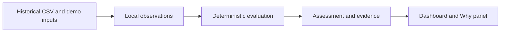

# NASA Space Apps · Two-day team plan

> **Current ownership:** Read [the team update](team-update.md) first. Amine owns the dashboard, Nassim owns the shared frontend UI/UX layer, and Fadoua owns the crew fixture and evidence/demo. That update overrides older owner names, branch suggestions and path restrictions below; technical requirements and task IDs remain unchanged.

**Project:** Offline astronaut health monitoring prototype  
**Team:** El Mahdi, Hamza, Amine, Mohsine, Fadoua and Nassim
**Schedule:** Day 1 and Day 2. El Mahdi sets the internal freeze and submission checkpoints from the event deadline once the team confirms it.

## 1. What ships

The astronaut opens a local dashboard, sees whether a reading is usable, and can open **Why?** to trace the assessment to readings, timestamps, sources and the rule that ran.

| Demo | Inputs | Result |
|---|---|---|
| A · One detector goes quiet | Historical NASA RadLab data, two ISS Columbus detectors | One source becomes stale while the other stays current. The dashboard shows the last reading and its age. The source recovers when the next reading arrives, and the incident stays in the history. |
| B · Sleep and vigilance change together | Labeled synthetic crew history, optional self-report and a short local reaction-time task | Recent sleep and vigilance changes appear together with the evidence behind them. When the reaction test is missing, show the gap and offer a check. If the check is unavailable, keep the assessment pending and show the available inputs. |

**Core interface:** scenario selector, replay controls, latest readings, one assessment panel, **Why?** evidence drawer, incident history, and an optional crew check-in. Use direct labels such as **Historical NASA telemetry**, **Synthetic crew scenario**, and **Recorded on this device**.

**Stack:** React + TypeScript + Vite, FastAPI, SQLite. Build the frontend once and serve it from FastAPI on loopback for the demo. Bundle the data and frontend assets locally. Use ordinary HTTP requests and a client-controlled replay clock. Use templates for the main explanations. A local-model paraphrase is a stretch goal after offline rehearsal. It can receive approved structured text and actions, with the canonical evidence and action labels rendered directly.

**Scope cut:** Two scenarios, one demo crew member, one pair of detectors. Put new health scenarios, clinical alarms, real crew data, live feeds, and additional sensors on the backlog. Within the behavioral scenario, track optional fatigue, mood and stress as self-reports. Show mood and stress in the crew check-in only. The demo app uses synthetic/sample entries for those fields, with loopback access and no remote transfer. Real crew privacy and access controls require a separate design.

## 2. System boundaries



- The existing research pipeline profiles datasets and produces candidates for human review. The evidence registry supplies published context. The app loads the approved demo policy and evaluates observations. These are separate dependencies with separate owners.
- Save original observations with stable IDs. Use a deterministic tie-break on observation ID if timestamps match. Reject or flag exact source/metric/time duplicates in fixtures rather than silently merging them. Historical imports retain the source timestamp string. Normalize timestamps for comparisons and document the RadLab replay time convention. The RadLab CSV carries timestamps without offsets. The demo adapter interprets them as UTC, preserves the source string, and tests the values against the fixed replay clock. For a browser reaction check, record capture time separately in metadata and use mission time for replay ordering.
- Use one evaluation function with an explicit `as_of` and a versioned policy. Replay results depend on observations available at that time. A rewind reproduces the earlier view. Source status, assessment state and suggested action are separate fields.
- Every inference references the observation IDs, including baseline inputs where applicable. Show missing and conflicting evidence as distinct states in the UI. With two plausible but conflicting sources, surface the disagreement and request corroboration when available. Leave fault attribution unresolved.
- SQLite owns crew submissions and run state. Seed fixtures are read-only. A new run gets its own ID and the same seed fixtures. Treat reset as starting a fresh run. Scope user entries to their run and scenario. Use transactions for writes and unique constraints for duplicate submission IDs. Store or derive incidents consistently so refreshing and seeking cannot multiply them.

## 3. Runtime contract · commit at kickoff

El Mahdi commits `contracts/v1.md` and the two JSON examples below. Hamza agrees on the evaluator call with him before either implementation starts. Fadoua checks that the examples and demo instructions agree. The frontend owners can start from the examples and stubbed callbacks.

### Endpoints and time

| Request | Response and behavior |
|---|---|
| `POST /api/v1/runs` with `{"scenario_id":"radlab_stale"}` or `{"scenario_id":"sleep_vigilance"}` | `201` and `{"run_id":"…","scenario_id":"…","initial_as_of":"…","range_start":"…","range_end":"…"}`. The RadLab range is fixed from `2022-04-01T23:00:00Z` through `2022-04-02T01:04:59Z`. For the behavioral fixture, use `2026-01-10T09:00:00Z` as the initial time and range start, and `2026-01-10T10:00:00Z` as the range end. Baseline and sleep rows before the range are visible as history. |
| `GET /api/v1/runs/{run_id}/state?as_of=<UTC ISO timestamp>` | `200` and the state envelope below. Read-only, with an explicit `as_of`. Parse it as a timestamp and enforce the run range. Observations and incident transitions after `as_of` stay out of the response. |
| `POST /api/v1/runs/{run_id}/observations` | Behavioral scenario only. Accept `submission_id`, `observed_at`, and a batch of entries `[{metric,value,unit,source_id,metadata?}]`. The UI supplies the current mission clock for a new check-in. Server validates scope, units, source, timestamps and per-metric input shape, then adds IDs, subject and provenance. First insert `201`, identical retry `200` with the same IDs, different payload with the same submission ID `409`. The batch is atomic. |
| `GET /api/v1/runs/{run_id}/observations?as_of=<UTC ISO timestamp>&source_id=<optional>&metric=<optional>&limit=180` | `200` and `{"observations":[...]}`, in chronological order. Select the most recent matching observations up to the limit before ordering them for display. Use this for the chart/history. The state endpoint includes every observation referenced by the returned evidence, source statuses, or incident history, with each ID included once. |

Unknown run returns `404`. Invalid payload, metric, source, unit or time range returns `422` with a message the UI can display. Network errors get a retry state. On seek or reset, the UI discards a response for an older clock or run if it arrives late.

### State fields

- **Observation** — `id`, `subject_id` (null for cabin telemetry), `metric`, `value`, `unit`, `observed_at`, `source_id`, `provenance` and optional `source_timestamp` and `metadata`. Preserve input metadata needed for comparability and auditing. Provenance values are `REAL_HISTORICAL`, `SYNTHETIC` and `LIVE_MEASURED`. In the demo input form, numeric self-reports are labeled as sample entries and stored as synthetic. A reaction test actually performed on the laptop is `LIVE_MEASURED`.
- **Source status** — `source_id`, `metric`, `state`, `last_observation_id`, `age_seconds`, `reason_code`. States are `current`, `stale`, `missing`, `invalid` and `conflicting`. Last ID and age are null when there is no reading. A stale observation can be displayed with its age and historical label.
- **Evidence** — `code`, `observation_ids` and `detail`. Baseline comparisons add `baseline_id` and the baseline observation IDs. The engine provides the detail string for the demo. The UI renders supporting, conflicting and missing evidence from the assessment.
- **Assessment** — `id`, `rule_id`, `rule_version`, `state`, `title`, `supporting_evidence`, `conflicting_evidence`, `missing_inputs`, and `action_ids`. States are `observed`, `watch` and `insufficient_data`. An assessment may have no supporting evidence if inputs are missing. A complete comparison can report that the demo pattern did not trigger.
- **Action** — `id`, `label`, `required_resource_ids`, `available`, `unavailable_reason` (null when available). IDs point to an existing UI action or a read-only information panel. Resources are determined by scenario configuration. Keep unavailable actions visible with a reason and expose an available fallback.
- **Incident** — `id`, `source_id`, `state` (`open` or `resolved`), `opened_at`, `closed_at` (null while open), and `last_observation_id` for the observation that preceded the gap. Its stable ID is derived from source and preceding observation, within the run. The state envelope includes incidents known by `as_of`.

### Example A · archive at 23:20:00

Copy this block to `contracts/examples/radlab-stale.json`. Identifiers are fixture IDs. Both numeric readings and both ages come from the downloaded CSV.

```json
{
  "schema_version": 1,
  "run_id": "example-radlab",
  "scenario_id": "radlab_stale",
  "as_of": "2022-04-01T23:20:00Z",
  "sources": [
    {"source_id":"DosTel1","metric":"absorbed_dose_rate","state":"stale","last_observation_id":"d1-231225","age_seconds":455,"reason_code":"older_than_demo_window"},
    {"source_id":"DosTel2","metric":"absorbed_dose_rate","state":"current","last_observation_id":"d2-232000","age_seconds":0,"reason_code":"within_demo_window"}
  ],
  "observations": [
    {"id":"d1-231225","subject_id":null,"metric":"absorbed_dose_rate","value":1.65945,"unit":"µGy/h","observed_at":"2022-04-01T23:12:25Z","source_id":"DosTel1","provenance":"REAL_HISTORICAL","source_timestamp":"2022-04-01T23:12:25"},
    {"id":"d2-232000","subject_id":null,"metric":"absorbed_dose_rate","value":2.211496,"unit":"µGy/h","observed_at":"2022-04-01T23:20:00Z","source_id":"DosTel2","provenance":"REAL_HISTORICAL","source_timestamp":"2022-04-01T23:20:00"}
  ],
  "assessments": [
    {"id":"demo-radlab-status","rule_id":"SOURCE_FRESHNESS","rule_version":1,"state":"watch","title":"DosTel1 stale · DosTel2 current","supporting_evidence":[{"code":"source_age_exceeds_window","observation_ids":["d1-231225"],"detail":"DosTel1 last reported 7 min 35 s ago."},{"code":"other_source_current","observation_ids":["d2-232000"],"detail":"DosTel2 reported at the current replay time."}],"conflicting_evidence":[],"missing_inputs":[],"action_ids":["view_source_history"]}
  ],
  "actions": [
    {"id":"view_source_history","label":"Review source history","required_resource_ids":[],"available":true,"unavailable_reason":null}
  ],
  "incidents": [
    {"id":"stale-DosTel1-d1-231225","source_id":"DosTel1","state":"open","opened_at":"2022-04-01T23:17:26Z","closed_at":null,"last_observation_id":"d1-231225"}
  ]
}
```

### Example B · sleep history present, reaction test missing

Copy this block to `contracts/examples/sleep-vigilance-missing.json`. The baseline is the median of five seeded reference nights: 450, 440, 450, 460 and 445 minutes. The matching seeded reaction-test baseline is 250 ms, from 245, 250, 255, 248 and 252 ms. The production fixture includes all baseline rows. The response below shows the supporting observations referenced by this assessment. The demo moves from missing to the labeled sample by seeking from 09:00 to 09:01. Keep the replay clock paused at 09:00 when trying a live check so the sample is still in the future.

```json
{
  "schema_version": 1,
  "run_id": "example-crew",
  "scenario_id": "sleep_vigilance",
  "as_of": "2026-01-10T09:00:00Z",
  "sources": [
    {"source_id":"crew_sleep_log","metric":"sleep_duration","state":"current","last_observation_id":"sleep-10","age_seconds":7200,"reason_code":"scheduled_input_received"},
    {"source_id":"reaction_task","metric":"reaction_time","state":"missing","last_observation_id":null,"age_seconds":null,"reason_code":"current_session_missing"}
  ],
  "observations": [
    {"id":"base-sleep-1","subject_id":"crew-demo-1","metric":"sleep_duration","value":450,"unit":"min","observed_at":"2026-01-01T07:00:00Z","source_id":"crew_sleep_log","provenance":"SYNTHETIC"},
    {"id":"base-sleep-2","subject_id":"crew-demo-1","metric":"sleep_duration","value":440,"unit":"min","observed_at":"2026-01-02T07:00:00Z","source_id":"crew_sleep_log","provenance":"SYNTHETIC"},
    {"id":"base-sleep-3","subject_id":"crew-demo-1","metric":"sleep_duration","value":450,"unit":"min","observed_at":"2026-01-03T07:00:00Z","source_id":"crew_sleep_log","provenance":"SYNTHETIC"},
    {"id":"base-sleep-4","subject_id":"crew-demo-1","metric":"sleep_duration","value":460,"unit":"min","observed_at":"2026-01-04T07:00:00Z","source_id":"crew_sleep_log","provenance":"SYNTHETIC"},
    {"id":"base-sleep-5","subject_id":"crew-demo-1","metric":"sleep_duration","value":445,"unit":"min","observed_at":"2026-01-05T07:00:00Z","source_id":"crew_sleep_log","provenance":"SYNTHETIC"},
    {"id":"sleep-08","subject_id":"crew-demo-1","metric":"sleep_duration","value":380,"unit":"min","observed_at":"2026-01-08T07:00:00Z","source_id":"crew_sleep_log","provenance":"SYNTHETIC"},
    {"id":"sleep-09","subject_id":"crew-demo-1","metric":"sleep_duration","value":370,"unit":"min","observed_at":"2026-01-09T07:00:00Z","source_id":"crew_sleep_log","provenance":"SYNTHETIC"},
    {"id":"sleep-10","subject_id":"crew-demo-1","metric":"sleep_duration","value":420,"unit":"min","observed_at":"2026-01-10T07:00:00Z","source_id":"crew_sleep_log","provenance":"SYNTHETIC"}
  ],
  "assessments": [
    {"id":"demo-sleep-vigilance","rule_id":"SLEEP_VIGILANCE","rule_version":1,"state":"insufficient_data","title":"Vigilance data missing","supporting_evidence":[{"code":"repeated_short_sleep","observation_ids":["sleep-08","sleep-09","sleep-10","base-sleep-1","base-sleep-2","base-sleep-3","base-sleep-4","base-sleep-5"],"baseline_id":"crew-demo-sleep-v1","detail":"Two of the last three logged nights were at least 60 minutes below the 450-minute demo baseline."}],"conflicting_evidence":[],"missing_inputs":["reaction_time"],"action_ids":["start_reaction_check"]}
  ],
  "actions": [
    {"id":"start_reaction_check","label":"Run reaction check","required_resource_ids":["local_reaction_task"],"available":true,"unavailable_reason":null}
  ],
  "incidents": []
}
```

For scheduled inputs, `last_observation_id` and `age_seconds` refer to the latest observation eligible for the current assessment. A baseline or prior session can remain visible in history when the current session is missing.

## 4. Rules for the demo

| Rule | Deterministic behavior | What the evidence supports |
|---|---|---|
| `SOURCE_FRESHNESS@1` | For each configured source, find its latest eligible reading at or before `as_of`. At whole-second precision, current through age 300 s, stale from 301 s. Create one incident at +301 s and close it on the first subsequent reading. A source with no eligible reading is missing. Keep the last reading visible with its age. | The RadLab archive supplies measurement timing and the observed gap. The 300 s setting is a demo choice. Use it per source. It describes data freshness, and the gap’s cause is unknown. |
| `SLEEP_VIGILANCE@1` | At the scheduled morning assessment, use the three most recent scheduled overnight slots, one valid sleep value per slot. Require all three and a five-night seeded baseline. Short sleep means ≥60 min below baseline in at least two slots. Require a comparable reaction result from the current session and its five-test baseline. Slower means ≥20% above that baseline. If both conditions are true, return `watch` and **Sleep and vigilance change**. If required inputs or comparable baselines are missing, return `insufficient_data` and identify the inputs. Otherwise return `observed`. | Agent 2 linked the association to `EVID_SLEEP_003` and `EVID_COG_001`. The window, baseline count and cutoffs are explicit prototype settings. The result is a comparison with the demo baseline. It establishes neither a diagnosis nor the cause of the change. |

Behavioral fixture uses Jan 8–10 as the three sleep slots and Jan 10 morning as the reaction session. Seed a **clearly labeled sample result** of 310 ms available at `09:01:00Z`. This is 24% above the 250 ms fixture baseline and should trigger `watch`. The live browser task may produce any value. Preserve the sample result for a repeatable demo and give live results their own source metadata.

Record median response time from completed valid trials, with trial count, false starts and task version as metadata. Make a 30–60 second local reaction check with practice/instructions and a keyboard control. Compare only complete tests with the same task version and declared comparable input setup. An interrupted task creates no completed result. The fixture comparability profile is synthetic; a changed device/profile gets an observed result that stays in history with comparability unknown. The short task measures the demo’s response time. It has no clinical cutoff.

Keep fatigue optional and descriptive. Mood and stress stay in the check-in. A blank field remains missing. When the reaction task resource is disabled, show **Reaction check unavailable** and offer **Review available inputs**. Keep the assessment pending. Avoid presenting a sleep log or a self-report as a substitute for the missing reaction result.

## 5. Team assignments

| Teammate | Owns | Day 1 target | Day 2 target |
|---|---|---|---|
| **El Mahdi** · `build/engine` | Shared contract, deterministic engine, rule config, PR review and merges | Keep contract/engine green; publish D2/D3 | Review integrations, merge passing PRs, approve the submission build |
| **Hamza** · `build/replay-api` | FastAPI, SQLite, fixture loader, shell/adapter and local launch | Loader and real state path; publish dashboard props | Wire dashboard/check-in, offline launch, B05 |
| **Amine** · `build/dashboard` | Dashboard, readings, replay controls, Why drawer and incident list | Render the two JSON examples with stub props | Verify recovery and missing-input flow on the integrated app |
| **Mohsine** · `build/checkin` | Crew check-in and short local reaction task | Standalone form against a fake callback | Submit a completed result; verify skip, cancel and unavailable states |
| **Fadoua** · `build/demo-qa` | Labeled synthetic crew fixture, evidence, acceptance, pitch and recording | Deliver the 14-row fixture and checks | Run offline acceptance, record and prepare submission text |
| **Nassim** · `build/frontend-ui` | Shared UI kit, design tokens, dashboard/check-in visual integration, accessibility and visual QA | UI kit and state gallery; pair with Amine/Mohsine | Integrate, verify responsive/offline visuals, support X01 |


Amine, Mohsine, Fadoua and Nassim can start from their brief below without reading either research repository. Each person runs the acceptance check in their brief and attaches the result to their PR. Use the existing tooling and dependency manifests. Ask El Mahdi to coordinate a shared-file change before editing it.

### Instructions to paste into every agent session

> **Inputs.** Use this plan, your named brief, the kickoff commit, and the applicable acceptance checks. Read the repository's instructions and inspect the current branch, worktree status and files before editing. Use the paths and toolchain from the kickoff commit. The contract and rule policy in that commit are authoritative. If a later approved contract differs from an example, use the approved contract and flag the example to El Mahdi.
>
> **Edits.** Work in your assigned branch and write only inside the paths in your brief. Treat other paths as read-only. Leave existing user changes intact. Scope commits to your files and leave merging to El Mahdi. Use the repo's current dependencies and commands. Dependency, lockfile, shared config and entry-point changes go to Hamza and El Mahdi. Stay within the two demo scenarios.
>
> **Missing input.** Use the named stub or fixture in your brief while waiting for another owner. Keep stubs in preview or tests and label them as such. If a required input or interface is ambiguous, report the exact file or field, what you observed, who owns it, and the smallest decision needed. Finish the work that can be verified independently. Keep affected checks marked **Blocked** until the dependency is available.
>
> **Claims.** Derive measurements, times and status from the supplied data or contract. Cite the record when presenting scientific evidence. Use the supplied prototype parameters. Leave missing data missing. Report exact commands and observed results. Mark checks **Pass**, **Fail**, **Blocked** or **Not run**, including when a mock passes and the integrated app is pending.
>
> **Before handoff.** Run `git status --short` and `git diff --check`. Review the whole branch diff from the kickoff commit, plus any untracked files. Check each changed path against your brief. Hand off the branch, changed files, command or click path to verify it, checks and results, and any question or blocker with its owner. Avoid broad formatting changes and cleanup outside your task.

### Kickoff decisions to publish in the contract

El Mahdi writes these into the shared contract. Hamza confirms the API and component signatures, then owns their wiring. Other agents use the committed signatures and submit discrepancies to the owner. The plan supplies these defaults so the two leads can resolve the interfaces in one pass.

| Shared decision | Default for the two demos |
|---|---|
| Clock and identity | Pass explicit UTC ISO timestamps at whole-second precision for the replay state. Use the run ID to isolate submissions. Example JSON observation IDs are opaque fixture IDs. The real importer generates stable IDs from source and normalized observation time. Select the greatest `(observed_at, id)` tuple, comparing IDs lexicographically when timestamps tie. |
| Rule ownership | El Mahdi owns the evaluator and versioned policy. Hamza passes the policy, configured resources and observations through `as_of`. The UI displays the returned states and actions directly. The contract examples are for preview and verification. |
| Form entry names and units | `crew_sleep_log`: `sleep_duration` in `min`, numeric 0–1440. `crew_self_report`: `fatigue`, `mood`, `stress` in `score_0_10`, integers 0–10. `reaction_task`: `reaction_time` in `ms`, finite and positive. Blank optional scores are omitted; 0 is a value. These bounds validate the input format. |
| Reaction metadata | Use `task_version`, `input_profile`, `trial_count`, `false_starts` and `completed`. Use `task_version: "demo-rt-v1"` and `input_profile: "seeded-demo"` for all seeded comparable tests. Use `input_profile: "browser-keyboard"` for a newly captured keyboard check and record its real capture time separately from replay time. The engine requires a matching task and comparable profile. With the seeded baseline, a newly captured browser result is visible in history and insufficient for the comparison. |
| UI handoff | Hamza publishes types and mounts both components. The dashboard receives state, current clock, scenario/checkpoint controls and an action callback. Check-in receives run/scenario/time, action availability and an async submit callback. Route `view_source_history` to history, `start_reaction_check` to the check-in and `review_available_inputs` to the evidence drawer. Define the last action as the available fallback when the task resource is disabled. |
| Time slots and selection | Seed sleep baseline on Jan 1–5, 2026, at 07:00 UTC and reaction baseline on the same dates at 09:00 UTC. Jan 8–10 UTC are the recent sleep slots. For each slot use the latest valid sleep value within that UTC day through `as_of`. Keep the seeded baseline fixed. The current reaction session is Jan 10 from 09:00 through 10:00 UTC. Evaluate the latest completed result in that session through `as_of`; if it is incomparable, report insufficient data. |

### El Mahdi · deterministic engine and PR review

> **Goal:** Build the logic that decides what the app displays, and keep the merged demo runnable.
>
> **Write in:** `contracts/`, `backend/engine/`, `rules/`, `tests/engine/`. You own merges to `main`. Hamza owns the shared app entry points and launch wiring.
>
> **Start:** Commit the two example JSON states and the contract. Agree with Hamza on one Python entry point. Suggested signature: `evaluate(scenario_id, run_id, as_of, observations, resources, policy) -> State`. Agree on where expected sources, scheduled slots and comparability metadata live. Hamza supplies run-scoped observations available through `as_of`, configured resources, and policy. The evaluator returns evidence, actions, source statuses and incidents with stable IDs.
>
> **Build in order:** Source freshness and incident transitions first. Then implement the behavioral rule with versioned parameters and baseline references. Implement missing and unavailable paths. Use fixtures and an explicit replay clock so the same inputs give the same result. Keep I/O and SQLite in Hamza’s layer.
>
> **Done when:** Engine checks pass for A02–A04 and B01–B04. You can explain each rule from raw observations and its config. Review each PR for owned paths, contract fit, a passing check, and any claim the demo makes about the data. Ask Hamza to review the engine PR as your second reviewer.

> **Inputs and artifacts.** Extract the two exact JSON blocks into `contracts/examples/`. Put the agreed evaluator, policy, inputs and UI action contracts in `contracts/v1.md`. Use engine tests with in-memory observations while Hamza builds I/O. Use the registry only to check evidence wording and references. Preserve the demo policy values in section 4.
>
> **Required decisions.** For each source, select the newest observation visible at `as_of`. A source with zero observations is `missing`, with no fabricated age. Derive stale intervals from successive readings. At whole-second precision, open at previous reading time +301 s if there is still no newer reading at that instant. A new reading at that exact instant takes precedence and creates no stale incident. Rewinding returns the incidents and transitions visible then. Keep old values visible as historical evidence.
>
> **Behavioral decision order.** Check baseline coverage and slot/session completeness first. Compute both medians and compare the measured values. At 60 min below or 20% above the respective demo baseline, the condition is met. A missing slot or incomparable test yields `insufficient_data`. Show every required evidence ID with its actual observation and preserve optional self-reports as context. An unavailable resource changes action availability and leaves missing reaction evidence unresolved.
>
> **Proof and boundary.** Show tests for the exact cutoffs, fresh data on the transition second, rewind, repeated evaluation, missing baseline, incomparable result and B01–B04. The engine returns statuses and actions, including blocked actions with a reason. Keep database writes, router handlers, UI text rendering and dependency changes with Hamza or their named owners.

### Hamza · replay, API and persistence

> **Goal:** Give the two UI features a running local app and connect them to El Mahdi’s evaluator.
>
> **Write in:** `backend/replay/`, `backend/api/`, `backend/storage/`, `fixtures/radlab/`, `tests/replay/`, `tests/api/`, app entry points and shared build/launch files. Own the frontend shell and shared API adapter. Preserve existing dependencies unless you coordinate changes with El Mahdi.
>
> **Start:** Stub the four endpoints from section 3 and expose the two contract examples so Hamza and Mohsine can work immediately. Share the adapter interface with both. Pass run ID, scenario, clock state and callbacks into their components.
>
> **Build in order:** Import the linked RadLab CSV unchanged. Verify its hash and source counts. Add read-only state and history by explicit `as_of`. Call El Mahdi’s evaluator. Add SQLite run creation and atomic, idempotent submission. Load Fadoua’s crew fixture. Finish with one documented offline launch command and a fresh-run smoke test. Use named checkpoint buttons if continuous playback is taking too long.
>
> **Done when:** A01–A04, B05 and X01 pass on the integrated path. In the PR, include the launch command, CSV count/hash, and a short recording or output showing run creation, a stale/recovered seek and an identical submission retry.

> **Inputs and artifacts.** Use the linked, checksum-matched CSV and Fadoua's approved JSON. Put raw archive bytes and a short provenance note under `fixtures/radlab/`. Put route adapters and run/submission persistence in the folders in your brief. Put the startup command in the repo's existing run instructions or the launch file you own.
>
> **Build against stubs first.** Stub state from `contracts/examples/`, keep preview clearly labeled, and publish the component prop types early. Once the real evaluator is wired, make the integration check fail on evaluator errors so preview data cannot hide a broken API. When the CSV is unavailable or has a bad hash, report that exact condition. A fake CSV is usable only in tests.
>
> **Data and concurrency.** Map `instrument_id` to `source_id`, preserve `module` and `spacecraft` in observation metadata, keep the raw timestamp string, and use `µGy/h` for absorbed dose rate. Pass only visible observations to the evaluator. Read-state and history requests leave run data unchanged. Use a uniqueness constraint for `(run_id, submission_id)` and one transaction per batch. Compare the validated payload on retries, retain original IDs, and test that identical concurrent retries produce one stored batch. Derive provenance and subject from the run and input source on the server.
>
> **Proof and boundary.** Verify 84/96 records, known UTC stops, reset isolation, `404`/`422`/`409`, response-order handling, and the offline launch. Provide one command and exact expected screen for the smoke test. Wire the UI features through their exports, and route feature edits to Hamza or Mohsine.

### Hamza · mission dashboard

> **Goal:** Put both example states on screen and show the evidence behind each one.
>
> **Write in:** `frontend/src/dashboard/` and tests colocated there. Read the JSON examples under `contracts/examples/`. Import them for a preview or accept them as props. Shared entry-point and API edits go to Hamza.
>
> **Build in order:** (1) Render the two source cards with source name, state, age and timestamp. (2) Render the assessment and **Why?** drawer from its evidence, missing inputs and observation IDs. (3) Show the incident once, including after recovery. (4) Add scenario/checkpoint controls that call the parent’s callbacks. Start with named stops, then add play/pause and a timeline when the basic flow works. Show the provenance label from each observation.
>
> **Done when:** The RadLab fixture displays **DosTel1 stale · DosTel2 current** and shows ages 455 s and 0 s. The crew fixture displays **Vigilance data missing** and links the action callback. On the integrated build, verify A03, A04, B01 and B04. Attach a screenshot of both states and a short note identifying the component export.

> **Inputs and artifacts.** Use the two contract JSON states, Hamza's component props and the acceptance checks. Export the dashboard component from your feature folder. Read incoming state to render each card. A development preview can load the contract examples.
>
> **Render directly.** Join evidence `observation_ids` to the envelope's observations to show source, value, unit and timestamp. Render evidence text, source states, missing inputs, actions and unavailable reasons from the response. If a reference is absent, show **Evidence unavailable** and report the ID to El Mahdi. If a source has no observation, use **No reading** and omit the age. Preserve `0` as a valid age. Display stale readings with the stale badge. Use the supplied incident ID as the row key.
>
> **Wiring and proof.** Let the shell own clock changes and API requests. Your controls call its callbacks. Build the fixed checkpoints first. Show the initial, stale and recovered views on the integrated run, and verify the missing reaction and unavailable action states. Send screenshots labeled **Fixture preview** or **Integrated run**. Keep status inference, fallback data, fetch clients, global CSS and route edits out of the dashboard feature.

### Mohsine · crew check-in

> **Goal:** Let the demo crew member record sample sleep and optional self-reports, or complete a short local reaction check.
>
> **Write in:** `frontend/src/checkin/` and tests colocated there. Accept run ID, scenario, current mission time, action availability and an async submit callback as props. Hamza wires the callback to the API.
>
> **Build in order:** (1) Add sleep in minutes and optional sample fatigue, mood and stress inputs. Omit blank inputs. Show a success or retry state after submission. (2) Add a keyboard-accessible reaction check with instructions, a practice step, a visible completion state and cancel. Measure elapsed response time using the browser’s monotonic timer. Submit a median from completed valid trials with task version, trial count and false starts. (3) When the engine says the resource is unavailable, show its reason and expose the input-review fallback. Preserve a submission ID across retries of the same input.
>
> **Done when:** In the preview, blank optional inputs are omitted, cancel creates no reaction result, a complete check calls the stub once, and the unavailable view still shows the fallback. In the app, verify B01, B04 and B05 with Hamza. Attach a short recording or screenshots and the component export. A live reaction result may differ from the demo sample.

> **Inputs and artifacts.** Use Hamza's props and the input names and units above. Keep local form state, reaction task logic and styles in the check-in folder. Use a fake submit callback in preview. Separate sample self-reports from the reaction test measured on the device.
>
> **Form and task.** Omit blank inputs, keep zero values, and surface invalid input before submit. Use an early key press as a false start and ignore held-key repeats. Use `performance.now()` for measured elapsed time. Count valid trials and calculate their median. Keep practice trials out of the submitted result. A cancel or navigation away clears timers and submits nothing. An empty completed-trial set yields no result. Store the version and profile from the contract, and use the resource availability and reason returned by the engine.
>
> **Submission and proof.** Disable duplicate clicks during submission. On retry, reuse the original payload, mission timestamp and submission ID. A changed payload starts a new submission. Confirm with a spy callback that blanks are absent, zero is retained, cancel submits nothing and one completed task submits once. Verify available/unavailable UI with a stub, then run B05 with Hamza. Keep seeded reaction numbers and decisions about comparability in the fixture and engine layers.

### Fadoua · synthetic fixture and expected results

> **Goal:** Give the engine, API and dashboard one repeatable crew scenario with numbers the team can check by hand.
>
> **Write in:** `fixtures/crew/` and `tests/fixtures/`. Confirm the seed file shape with Hamza. Use the timestamps, IDs and values in sections 3 and 4. Leave contract and rule changes to El Mahdi.
>
> **Build in order:** (1) Create `fixtures/crew/sleep-vigilance.json` with the five sleep baseline rows, five comparable reaction baseline rows, three recent sleep rows and the sample 310 ms result at `09:01:00Z`. Set the provenance of every seed record to `SYNTHETIC`. Use stable unique IDs. (2) Create a small expected-results file and a check for unique IDs, timestamps, provenance and the two baseline medians. (3) Add test variants for a 270 ms comparable reaction result, one missing sleep night and an incomparable reaction result.
>
> **Done when:** The fixture proves the expected arithmetic for B01–B03. The 09:00 snapshot excludes the future sample, the sleep baseline is 450 min, and the 09:01 snapshot has the 310 ms result against 250 ms. Hand Hamza the fixture path and exact load command or test command. Keep all seed values synthetic.

> **Inputs and artifacts.** Use the exact values and timestamps in sections 3 and 4 and the kickoff table. Create one file with the 14 canonical observations. Use the sleep IDs in the examples and agree on the reaction IDs with Hamza. Keep expected outcomes and variants in test files. Avoid copies of the raw archive or new dependencies.
>
> **Seed checks.** Verify five sleep baseline rows, five reaction baseline rows, three recent sleep rows and one seeded current reaction row. Assert unique IDs, correct source IDs and units, valid UTC timestamps, `SYNTHETIC` provenance on every row, and comparable metadata on the seeded reaction rows. Check 450 min and 250 ms baselines, two qualifying nights, no current reaction at 09:00, and one 310 ms current result at 09:01.
>
> **Variants and proof.** In tests, copy the fixture and change one condition per variant. At 270 ms expect `observed`, with one required sleep row removed expect `insufficient_data`, and with a mismatched reaction profile expect `insufficient_data`. Record these as expectations and verify fixture arithmetic locally. Label engine verification pending until the engine is available. Hand Hamza the fixture path, loader shape and command to run your checks.

### Fadoua · evidence, demo and acceptance

> **Goal:** Make the integrated app easy to demonstrate and catch wording or behavior that the evidence cannot support.
>
> **Write in:** `evidence/`, `acceptance/`, `demo/`. Use the rule IDs, source links and acceptance table in this plan. Ask El Mahdi to make any rule configuration change.
>
> **Build in order:** (1) Write a one-page manual checklist with the click path, expected screen and pass/fail box for each demo checkpoint. (2) Cross-check source labels, the RadLab gap wording and the two behavioral evidence IDs. Identify the demo thresholds as prototype choices. (3) Prepare the two-minute pitch, screenshots and submission copy. Once the integrated build is ready, run the walkthrough with Wi-Fi off and record the backup demo.
>
> **Done when:** A teammate can reproduce A01, B02 and X01 from your checklist. Every claim in the pitch can be traced to the archive, the labeled synthetic fixture or a cited source. Your PR includes the checklist, pitch, result of the offline run and the location of any recording.

> **Inputs and artifacts.** Use sections 7 and 8 and the two available fixtures. Write a checklist in `acceptance/`, a script and submission copy in `demo/`, and source notes in `evidence/`. Keep a claim/source table covering what is measured, what is simulated and what each rule reports. Leave the existing registry intact unless you have a concrete citation correction with a source.
>
> **Claims to verify.** The radiation values come from historical ISS detectors and the cause of the archive gap is unknown. The crew baseline and sample reaction result are synthetic. An actual browser reaction result belongs to that device session. The threshold and time windows are versioned prototype settings. Before quoting a registry claim, verify the specific evidence record and source. If the registry or a source is unavailable, mark that claim unverified and use wording supported by the material you have.
>
> **Checklist and proof.** Write exact click paths and expected screens before the integrated app arrives. Record the build commit and scenario timestamp beside each pass/fail result. If the app is incomplete, record **Blocked** with the owning teammate. Use the merged build for the final offline test and confirm that Wi-Fi was disabled before launch. Record a backup and give El Mahdi the recording location and submission draft for review.

### Git and handoffs

1. El Mahdi publishes the approved contract and examples. Hamza publishes the minimal shared shell and adapter types from his owned paths. Tag the commit or post its SHA as the shared base. El Mahdi and Hamza can work on engine and replay in parallel after agreeing on the evaluator signature. Amine, Mohsine and Nassim can start from fixture props and stub callbacks. Fadoua can start from the seed values and checklist.
2. Keep one branch per owner and use separate worktrees when agents share a checkout. El Mahdi owns the contract and all merges to `main`. Hamza owns the shared app entry points, API client, dependency manifests, lockfiles and launch wiring. Keep feature implementations in their feature folders. Amine owns the dashboard; Hamza owns the shared shell, adapter and wiring; Mohsine, Fadoua and Nassim leave shared files to their owners. On a shared-file conflict or pre-existing edit, send the path and intended diff to its owner and continue in your own files.
3. Merge Fadoua's fixture and checklist, Amine's dashboard, Mohsine's check-in and Nassim's shared UI kit when their standalone checks pass. Their PRs may mark integrated checks pending. Merge El Mahdi's tested engine and Hamza's real integration after the engine signature, fixture, UI kit and feature exports are available. Hamza reviews the engine PR. Fadoua runs the final acceptance checks against the merged build.
4. A contract change has one PR from El Mahdi with updated examples and the impacted owners listed. Those owners update from that commit. To review a feature PR, check changed paths, runnable verification, reported blockers and any source claims. Final demo claims and feature freeze use the verified integrated build.

## 6. Two-day checkpoints

| When | Checkpoint | If time is tight |
|---|---|---|
| **Day 1 · Kickoff** | El Mahdi and Hamza commit the contract, two examples and stub paths. Each teammate starts with their named brief and one acceptance check. | Publish the example JSON first. Amine and Mohsine can start with local props and fake callbacks. |
| **Day 1 · First integrated check** | The dashboard renders both states from the examples. The RadLab adapter reads the real file and the engine can produce the stale state. | Use fixed checkpoints at 23:12:25, 23:20:00 and 23:30:00. |
| **Day 1 · Before stopping** | RadLab replay works end to end. Fadoua’s crew fixture passes its arithmetic checks. The crew screen renders the missing-input state. | Land the missing and seeded sample states before the live task. |
| **Day 2 · First integrated check** | Both scenarios run through the local API. Verify the crew check-in, unavailable-resource path, incident recovery and reset. | Preserve the seeded behavioral walkthrough. Defer chart polish, continuous playback and local AI. |
| **Day 2 · Before the team’s submission checkpoint** | Freeze features. Run the offline acceptance checks, record a backup, fix blockers and verify submission. | Keep the last passing build and recording. |

## 7. Acceptance checks

| ID | Owner(s) | Check |
|---|---|---|
| A01 | Hamza, Fadoua | Raw CSV SHA-256 matches the checksum below. Import 84 DosTel1 and 96 DosTel2 records. No astronaut subject is assigned to either detector. |
| A02 | El Mahdi, Hamza | At `23:12:25` both sources are current. At `23:17:25` DosTel1 is current at exactly 300 s. One second later it is stale. |
| A03 | El Mahdi, Hamza, Amine, Nassim | At `23:20:00`, ages are 455 s and 0 s. Why shows both observation IDs or source/time/value details. Advancing inside the gap shows one open incident. |
| A04 | Hamza, El Mahdi, Amine, Nassim | At `23:30:00`, both are current. One resolved DosTel1 incident remains. Seek to before recovery and verify that no future reading or closure is shown. |
| B01 | El Mahdi, Mohsine, Hamza, Amine | At Jan 10 `09:00:00Z`, the result is insufficient data. Why shows 380, 370 and 420 min against 450 min. Mood/fatigue/stress can be blank. |
| B02 | El Mahdi, Fadoua | At `09:01:00Z`, the seeded 310 ms sample is 24% above the 250 ms baseline. Both required conditions are true. Why shows the baseline and observed values. |
| B03 | El Mahdi, Fadoua, Mohsine | Replace the sample in a test fixture with a comparable 270 ms result. Expect `observed`. Remove one required sleep night or make the current reaction test incomparable. Expect `insufficient_data`. |
| B04 | El Mahdi, Mohsine, Hamza | Disable the task resource. Show a reason and the available input-review action. Assessment stays pending. |
| B05 | El Mahdi, Hamza, Mohsine | Submit the same check-in twice with one submission ID. Same IDs return and one batch is stored. Changed payload with the same ID returns 409. New run has only its own seeded records. |
| X01 | Hamza, Amine, Fadoua, Nassim | Switch off Wi-Fi before launching the prepared build. Both scenarios, evidence drawers, local inputs and reset work. Repeat the two demos from a fresh launch. |

## 8. Pitch and sources

**Two-minute run**

- **0:00–0:20.** “An onboard health monitor has to know when its own evidence is incomplete. We’ll replay actual ISS data, then show how the same approach works for a crew check-in.”
- **0:20–0:55.** Seek to `23:20:00`. Open **Why?** on the stale detector. Point to both source timestamps, advance to `23:30:00`, and show the resolved incident.
- **0:55–1:35.** Switch to the crew scenario. Show the missing reaction result, then load the labeled sample result. Open **Why?** to show the sleep baseline, vigilance baseline, timestamps and rule.
- **1:35–2:00.** Show the offline local build and the rule reference. Explain that the first scenario uses archived NASA telemetry and the second uses synthetic crew data informed by published research.

**Data and evidence**

- RadLab snapshot: `iss-radlab-dostel-2022-04-01.csv`. SHA-256 `be73563615dbbd28b0b8548a0b9ba40c2059f3dc68ef8941203eb350dcc9e9fb`. Absorbed dose rate from two ISS Columbus detectors, in µGy/h. The UI describes detector readings. Crew exposure requires separate evidence. [CSV](https://chatgpt.com/library?file_id=libfile_e4dafb8215d0819180a1439721735543&account_id=personal) · [NASA RadLab API](https://visualization.osdr.nasa.gov/radlab/gui/data-api/)
- Behavioral rationale: Agent 2’s reported registry entries `EVID_SLEEP_003` and `EVID_COG_001`. Fadoua reviews the exact registry wording before citing it in the app. [NASA: Sleep on Station](https://www.nasa.gov/humans-in-space/science-in-space-week-of-sept-15-2023-sleep-on-station/)
- Codex’s planted sleep/reaction association stays a synthetic pipeline check. This plan uses the team’s reported research and evidence results. The registry and Codex pipeline were unavailable in this workspace when drafting. The RadLab checkpoint values in this plan were verified directly against the CSV.

## Kickoff message for the team

El Mahdi posts the link to the shared plan and the kickoff commit. Each teammate copies **Instructions to paste into every agent session**, the **kickoff decisions** table, their named brief, sections 3 and 4, and their acceptance checks into their agent. Give the agent the repo path and the branch name in the table. Ask it to inspect the project before creating files, stay within the assigned paths, and report exactly how to verify the result. Each person runs that check before requesting PR review.
